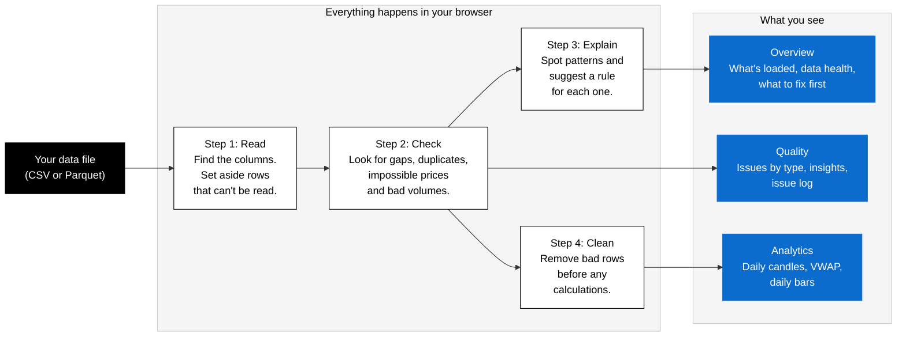

# Futures Dashboard

A simple web app that checks historical futures market data for problems and turns it into easy-to-read market views.

It opens on a public sample of 40 futures contracts across 8 markets, already loaded. You can also upload your own file. It tells you:

- **Can I trust this data?** It shows how much of the data is usable, then exactly what's wrong: missing data, duplicates, impossible prices and other errors.
- **Why is it wrong, and what should we do about it?** It spots recurring patterns and suggests a rule to fix or prevent each one.
- **What did the market do?** It shows daily candles and price summaries, and an intraday price chart with a 15-minute average trading price (VWAP).

It's built for the people who use and look after market data: traders, risk managers and analysts.

New to finance? Start with the [beginner's walkthrough](docs/BEGINNERS_GUIDE.md). It follows one contract through all three screens and explains each term as it comes up.

Your files never leave your computer. All the work happens inside your web browser.

> This is a prototype built for a coding exercise (brief in [`docs/`](docs/)). It's deliberately simple.

## Getting started

You'll need about 10 minutes the first time. After that, starting the app is one command.

**1. Install Node.js.** Node runs the app on your computer. Download the LTS version from [nodejs.org](https://nodejs.org) and install it like any other program. You need version 22.18 or newer. To check what you have, open a terminal and type `node --version`.

**2. Get the code.** On the [GitHub page](https://github.com/siewchung/market-analyser-prototype), click the green **Code** button, then **Download ZIP**, and unzip it. (If you use git: `git clone https://github.com/siewchung/market-analyser-prototype.git`.)

**3. Open a terminal in that folder.**

- Mac: open **Terminal**, type `cd ` (with a space), drag the unzipped folder onto the window, and press Enter.
- Windows: open the unzipped folder, click the address bar, type `cmd`, and press Enter.

**4. Install the app's building blocks.** This downloads what the app needs. It only needs doing once and takes a minute or two.

```bash
npm install
```

**5. Start the app.**

```bash
npm run dev
```

It prints a link, usually http://localhost:5173. Open it in Chrome, Edge or Firefox. You'll see the Overview screen with the sample data already loaded.

The app keeps running while the terminal is open. To stop it, click the terminal and press **Ctrl+C**. To start it again later, repeat steps 3 and 5.

### Optional: add the minute data

The app works without this, but the Analytics screen only shows daily bars until you do it. To see the intraday chart and VWAP:

1. Stop the app (Ctrl+C).
2. Run `npm run download-dataset`. This downloads about 100 MB.
3. Start the app again with `npm run dev`.

You'll see two lines starting with `WARNING` about `README.md` and `dataset.json`. That's expected. The dataset publisher's checksum list is out of date for those two files, and they aren't used by the app.

### If something goes wrong

- **`node` or `npm` "not found"**: Node isn't installed, or the terminal was open before you installed it. Close the terminal, open a new one, and try again.
- **An error mentioning `.ts` or "Unknown file extension"** when you run `download-dataset`: your Node is too old. Install the latest LTS.
- **The link doesn't open**: check the terminal is still running and use the exact address it printed. The number at the end can change if 5173 is already in use.

## What it doesn't do (yet)

Worth knowing before you start:

- **Uploads are one file at a time.** An uploaded file replaces the sample until you click **Reset to startup data**. The app can't join contracts into one continuous price history.
- **Holidays show up as gaps**, and market hours assume the main CME schedule.
- **Prices are shown as decimals**, not in 32nds as Treasury traders quote them.

The full list is under [Known limitations](#known-limitations).

## How it works



The three blue boxes are the three screens of the app. Problem counts always cover everything, while the market numbers are worked out from the cleaned data (you can switch that off).

For the built-in sample, steps 1 to 3 for the minute data were run ahead of time, because analysing all 5.3 million minute bars at once needs more memory than a browser tab has. The result is saved in `data/quality-report.json` and loaded at startup.

For the technical design behind this (layers, data flow, key types and how to extend the app), see [`docs/ARCHITECTURE.md`](docs/ARCHITECTURE.md).

---

## Using the app

### 1. The data

When the app opens, it loads the built-in sample: daily bars for 40 contracts across 8 markets (crude oil, S&P 500, gold, sugar, SOFR, VIX, corn and 10-year Treasuries), from a [public sample dataset](https://huggingface.co/datasets/lynx1231/historical-futures-data-sample). The quality report covers the minute data too, about 5.3 million one-minute bars.

To see minute charts and VWAP, download the minute data once (see [add the minute data](#optional-add-the-minute-data)). Without it, Analytics shows daily bars and says the minute data isn't downloaded.

To check your own data, click **Upload files** and choose a CSV or Parquet file. It replaces the sample until you click **Reset to startup data**. To see what the app catches, upload `tests/fixtures/dirty.csv`: a small made-up file with every kind of problem planted in it.

Your file needs a column for each of these: contract, timestamp, open, high, low, close. A volume column is optional. Common column names are recognised automatically, so "Contract", "contract_symbol" and "Symbol" all work.

### 2. The three screens

Switch screens with the tabs at the top.

**Overview: what's loaded, and can I use it?**

| Part | What it tells you |
|---|---|
| **Active dataset** | Where the data came from, when it loaded, how many files, contracts and records, and the dates covered. |
| **Data health** | The share of records usable for analytics, and how many errors, warnings and info findings there are. |
| **What to fix first** | The two most serious patterns found, each with a suggested rule. |
| **Contracts** | Every contract with its dates, bar count and issue count. Click **Analytics** to chart it. |

**Quality: exactly what's wrong, and what to do about it?**

| Part | What it tells you |
|---|---|
| **Counters** | Records read, accepted, rejected and issues found. Click **Rejected** to see the rows that couldn't be read, and why. |
| **Issues by type** | How many of each kind of problem, coloured by how serious it is. |
| **Insights** | The most useful part. Instead of thousands of individual warnings, it explains the patterns behind them and suggests a rule for each. |
| **Issue log** | Individual problems, filtered by **Errors**, **Warnings** or **Info**. It shows a sample (up to 200 of each severity) and says how many there are in total. |

**Analytics: what did the market do?**

| Part | What it tells you |
|---|---|
| **Filters** | Contract, date range, the day for the VWAP chart, and **Exclude bars with errors** (on by default). |
| **Daily OHLC** | One candle per trading day. Hollow green: closed up. Solid red: closed down. Shows the latest 60 days of the range. |
| **Rolling 15 minute VWAP** | Close price and VWAP through the chosen day. Needs minute data. |
| **Daily bars** | Open, high, low, close, volume, how many minute bars made up the day, and how many issues that day had. |

All times are shown in **Chicago time (CT)**, the exchange's own time zone, exactly as they appear in the source data.

### What the app checks for

| Problem | How serious | In plain terms |
|---|---|---|
| Rejected row | Error | Missing contract or price, or a timestamp that can't be read. The row is left out entirely. |
| Conflicting duplicates | Error | The same minute was sent twice with different numbers. Which one is right? |
| Impossible prices | Error | A price of zero or below, or a high that's lower than the low. |
| Exact duplicates | Warning | The same row sent twice. Harmless once removed, but a sign of a loading problem. |
| Bad volume | Warning | Volume that's missing, negative, or not a whole number of contracts. |
| Data gaps | Warning | A stretch of time with no data while the market was open. The normal daily break and weekends aren't counted. |
| Out of order | Warning | A row that's earlier in time than the one above it. |
| Unusual price moves | Warning | A price jump much bigger than normal for that contract (more than 10 times the typical move). |
| Flat bars, no trades | Info | Nothing traded and the price didn't move. This is usually a settlement price, not an error. |

### How problems affect the numbers

- **The counts, insights and issue log always cover all the data**, whatever filters you choose.
- **Analytics uses a cleaned-up copy of the data:**
  - Rejected rows are left out.
  - With **Exclude bars with errors** on (the default), impossible prices and the second copy of a conflicting duplicate are left out too. Turn it off to see what they would do to the numbers.
  - Exact duplicate rows are always counted once.
  - Negative volume is treated as missing.

### Jargon buster

| Term | Meaning |
|---|---|
| **Futures contract** | An agreement to buy or sell something at a set date. Each delivery month is a separate contract, e.g. ZNH26 = 10-year Treasury note, March 2026. |
| **OHLCV** | Open, High, Low, Close, Volume: the five numbers that describe trading over a period. |
| **Bar** | One period's OHLCV, e.g. one minute or one day. |
| **Volume** | How many contracts traded. |
| **VWAP** | Volume-weighted average price: the average price over a period, where prices with more trading count more. Here it's calculated over the last 15 minutes, updated every minute. |
| **Trading day** | Futures trading for a day starts at 5pm Chicago time the evening before. So Sunday evening's trading counts towards Monday. |
| **Settlement price** | The official end-of-day price set by the exchange, sometimes published even when nothing traded. |
| **CSV / Parquet** | Two common file formats for tables of data. CSV opens in Excel; Parquet is a compact format used by data teams. |

---

## Known limitations

- **Uploads are one file at a time and replace the sample.** There's no continuous history across contract rolls and no side-by-side comparison of contracts.
- **Minute data needs a download.** The sample's minute files (about 100 MB) aren't in the repo. Without them, Analytics shows daily bars only.
- **Only one contract's minute data is kept at a time.** Switching contracts reloads it, which takes about a second for a typical contract.
- **The sample's quality report is precomputed.** If the quality rules change, it must be regenerated with `npm run build-quality-report` (a test fails until it is).
- **Public holidays aren't known to the app.** A missing day of data on a holiday is flagged as a gap. The insights point out that missing weekdays are probably holidays.
- **Market hours assume the main CME electronic schedule.** Products with different hours will show gaps at their regular closed times. The insights spot these and suggest checking the product's trading schedule.
- **Prices are shown as decimals.** Treasury traders usually quote ZN in 32nds of a point (e.g. 112-08+). Here it's shown as 112.250000, because ZN trades in 1/64ths of a point and needs 6 decimals to be exact.
- **Long chart periods are simplified to 2,000 points** so the chart stays fast. Very brief spikes can disappear from the chart, but they're still in the issue list. A single day of minute data is never simplified.
- **The issue log shows a sample**: up to 200 issues of each severity. The counts are always complete.
- **Gap detection is noisy.** Across the sample it flags 337,793 gaps. The insights group them by contract, for example "SR3M26: 46,339 gaps spread across the trading day", which points to thin trading rather than a broken feed.
- **Blank lines in a CSV shift the row numbers.** After a blank line, row numbers are one lower than the line in Excel.
- **Thresholds are fixed:** gaps over 5 minutes, price moves over 10 times normal, and a 15-minute VWAP. They can be changed in code, but not yet in the app.
- **Daily figures won't exactly match the vendor's own daily file.** In the sample dataset, the minute data contains only about 76% of the volume reported in the daily data (107.3M vs 140.6M contracts for ZNH26, per the dataset's `files.csv`). Daily highs and lows match the vendor's on 62% of days.

## Next steps

These are ideas raised during review that were deliberately left out of the prototype:

- **Several contracts together.** Join contracts into one continuous history, and compare contracts side by side. This needs a rule for when to switch from one contract to the next.
- **Export.** Download the issue log and the cleaned data as CSV.
- **Exchange holiday calendar.** Stop flagging holidays as gaps.
- **Per-product settings.** Trading hours, and price formats such as 32nds for Treasuries.
- **Editable thresholds** in the app.
- **More daily columns.** Change, % change and daily range.
- **AI-written explanations** alongside the rule-based insights.

---

## For developers

### Run it

Tested on Node 26.

```bash
npm install
npm run dev        # then open the URL it prints (usually http://localhost:5173)
```

To share it with business users without them installing anything, run `npm run build`. Then host the `dist/` folder on any static web host. There's no server to run.

| Command | What it does |
|---|---|
| `npm run dev` | Start the app locally |
| `npm test` | Run all unit and integration tests |
| `npm run typecheck` | TypeScript strict-mode check |
| `npm run build` | Type check, then build a static site into `dist/` |
| `npm run fetch-sample` | Re-download the sample Parquet files into `tests/fixtures/` |
| `npm run download-dataset` | Download the full public sample (80 Parquet files, daily and minute, ~100 MB) into `sample-data/`. Gives Analytics its minute data. |
| `npm run build-quality-report` | Re-analyse the full sample, one file at a time, into `data/quality-report.json` (about 20 seconds). Run after changing a quality rule. |

### Key technical decisions

- **Timestamps stay in Chicago wall-clock time.** The source stores them that way and warns against converting them ([dataset README](https://huggingface.co/datasets/lynx1231/historical-futures-data-sample)). Internally they're read with `getUTC*` so the viewer's timezone and daylight saving can't shift them.
- **Trading day = CME session.** Bars from 17:00 CT onwards go to the next day. The dataset's own `trading_date` column is the calendar date, so it's ignored. Against the vendor's daily file, the session rule matches daily high and low on 62% of days, versus 26% for calendar dates. An integration test pins this.
- **The VWAP window is (t − 15 min, t]**, using typical price (H+L+C)/3. If nothing traded in the window, the result is `null`. It's calculated on the full history before filtering, so the edges of a date range are correct.
- **Startup loads daily data for every contract, minute data on demand.** Measured in Node: all 40 daily files take 0.3 s and 41 MB; all 40 minute files take 76 s and peak at 3.9 GB, too much for a browser tab. So minute data loads one contract at a time (about 0.65 s for ES in Chrome), and the minute quality report is precomputed. See [`docs/ARCHITECTURE.md`](docs/ARCHITECTURE.md).
- **The data files are found by Vite, not listed by hand.** The worker uses `import.meta.glob` on `data/daily/` and `sample-data/data/minute/`. If the minute folder is missing, its list is just empty.
- **The VWAP chart defaults to one day.** A 15-minute VWAP is an intraday measure; months of minute data in one chart hide it. With no date filter, the chart opens on the latest day with at least 60 bars. The very latest day can be nearly empty, e.g. for an expiring contract.
- **Daily data charts the whole file, without VWAP.** A contract counts as daily when it never has more than one bar per trading day. This is judged on the whole file, so a narrow date filter can't make minute data look daily.
- **Filters and view options are separate.** `Filter` (contract, dates, exclude errors) changes what Analytics works from. `ViewOptions` (VWAP day) only changes what's displayed, so picking another day doesn't shrink the daily table.
- **Quality checks run once on all the data.** Filters only change Analytics.
- **No backend and no database.** One file is a few hundred thousand rows at most, which plain TypeScript in a Web Worker handles in about a second. It also keeps every rule typed and unit-testable. DuckDB-WASM could replace the internals of `load()` and `query()` later without touching the UI.
- **Insights are rule-based, not AI.** They're deterministic, testable and need no API key. An LLM step could be added behind the same `Insight` type.

### Testing

- 137 tests, all pure Node (no browser needed).
- Unit tests cover every domain module, the report builder, the worker's file mapping and job queue, and the display helpers.
- Integration tests run real file bytes through the full pipeline:
  - Exact counts for every problem planted in `dirty.csv`, including Excel-matching row numbers.
  - Real ZN data: minute volume adds up to the vendor's reported total of 107,312,444.
  - Daily bars line up with the vendor's daily file on most days.
  - The exclude-errors toggle changes daily volume by exactly the planted bad bars.
- A test checks the committed quality report matches the current code version and covers all 80 files.
- The UI was checked by driving the running app in headless Chrome at desktop (1280px) and phone (390px) widths: startup, all three screens, uploading `dirty.csv`, the exclude-errors toggle, and fast contract switching. It has no automated UI tests.

### Project layout

```
src/domain/          business rules: pure TypeScript, no browser or file-format code
src/application/     load() and query(), and the quality report builder
src/infrastructure/  CSV/Parquet parsers and the background worker
src/ui/              React screens and components
data/                committed sample: 40 daily files and the precomputed quality report
scripts/             dataset download and quality report build
tests/               unit tests (mirroring src/), integration tests, sample files
```

[`docs/ARCHITECTURE.md`](docs/ARCHITECTURE.md) explains how the pieces fit together and how to extend them: new checks, insight rules and file formats.
