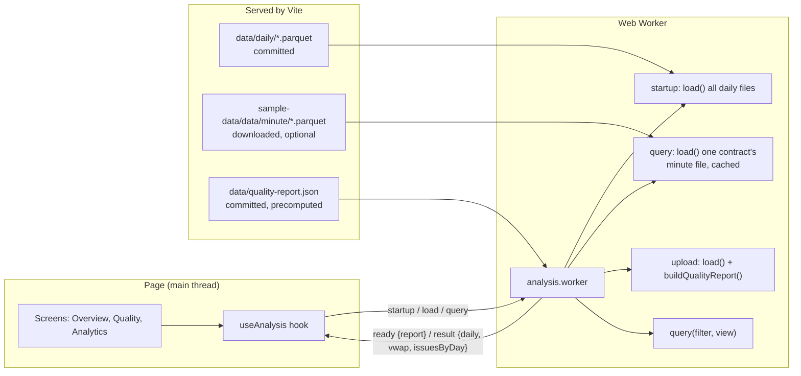

# Architecture

## In one paragraph

A single-page React app with three screens (Overview, Quality, Analytics), switched by the URL hash. All heavy work happens in a background Web Worker. At startup the worker fetches the 40 committed daily files, runs the pipeline on them (normalise, check, clean, analyse), and reads a precomputed quality report covering the full sample, minute data included. When Analytics asks for a contract, the worker fetches that contract's minute file, analyses it, and keeps it until another contract is picked. An uploaded file goes through the same pipeline and replaces everything until the user resets. Filter changes send a small query to the worker, which slices results it already has. The page never does heavy work, so it stays responsive.

## Data flow

## Why the data is served this way

Measured on 2026-10-28 in Node, one run each, with the app's own parser and `load()`:

| Load | Rows | Time | Peak heap |
|---|---|---|---|
| All 40 daily files | 30,102 | 0.3 s | 41 MB |
| All 40 minute files | 5,295,239 | 76 s | 3.9 GB |
| Largest minute file (SR3M26) | 679,428 | 4.5 s | 520 MB |

All the minute data at once doesn't fit comfortably in a browser tab, so it's never loaded together. Instead:

- **Daily data at startup.** 1.1 MB, committed in `data/daily/`, so a fresh clone works offline with no download.
- **Minute data on demand.** One contract at a time, in a one-entry cache. ESZ25 (116k rows) took 653 ms in Chrome.
- **The full report is precomputed.** `npm run build-quality-report` runs the same domain code over all 80 files, one at a time (22 s, 1.5 GB peak), and keeps only a small `FileAnalysis` per file. `buildQualityReport()` merges them into `data/quality-report.json` (91 KB). A version constant and a test catch a report that is out of step with the code.
- **File URLs come from `import.meta.glob(..., { query: '?url' })`** in the worker. Vite lists the files at build time, so there's no manifest to maintain. In a production build, matching files are copied into `dist/` with fingerprinted names, including the 100 MB of minute data if it has been downloaded.
- **Requests run one at a time** (`createSerialQueue`), and the hook ignores answers to superseded queries (`queryId`). So a slow minute download for one contract can never overwrite the chart for the contract the user switched to.

## Layers

Dependencies point inwards only. The domain doesn't know about React, browsers or file formats.

| Layer | Folder | Responsibility | Knows about |
|---|---|---|---|
| Domain | `src/domain/` | All business rules: normalising, quality checks, cleaning, daily bars, VWAP, insights | Nothing outside itself |
| Application | `src/application/` | `analyse.ts` wires domain steps into two use cases: `load()` (once per file) and `query()` (every filter or view change). It also defines what `query()` returns (`QueryResult`, `ViewOptions`), because those are shaped for the Analytics screen rather than being business rules. `qualityReport.ts` merges per-file analyses into one report. | Domain |
| Infrastructure | `src/infrastructure/` | Turning file bytes into rows (Papa Parse, hyparquet); finding, fetching and caching data files; running the pipeline in a worker | Application, domain types |
| UI | `src/ui/` | Rendering state and sending user actions to the worker | Worker protocol, domain types |

Keeping the domain pure is what makes it easy to test: every rule is a plain function tested with a few hand-built bars.

## Domain modules

| Module | Input → output | Notes |
|---|---|---|
| `normalise.ts` | raw rows → `Bar[]` + `RejectedRow[]` | Column aliases, type coercion (string, number, bigint, Date), CME trading-day assignment, row numbers as the user sees them. Throws `MissingColumnsError` if the file is unusable. |
| `quality/checks.ts` | `Bar[]` → `QualityIssue[]` | Seven independent checks. They run on bars in their original file order, so duplicates and ordering problems are still visible. |
| `quality/clean.ts` | `Bar[]` → `Bar[]` | Removes impossible prices and duplicates (first wins), blanks negative volume, sorts. |
| `analytics/dailyBars.ts` | clean bars → `DailyBar[]` | Groups by contract and trading day. |
| `analytics/vwap.ts` | clean bars → `VwapPoint[]` | Time-based sliding window with running totals, O(n). |
| `analytics/filter.ts`, `downsample.ts` | | Contract and date filter; thins chart data to 2,000 points. |
| `insights/rules.ts` | issues + bars → `Insight[]` | Eight rules that find patterns and suggest a cleansing or validation rule. |
| `health.ts` | summary → verdict; bars + issues → per-contract health | Per-contract counts and dates (used by the report). The good / caveats / poor verdict is no longer shown in the UI. |
| `bars.ts` | | Group-by-contract helper; per-contract price decimals for display. |
| `time.ts` | | Wall-clock helpers, the CME session calendar, trading-day rule. |
| `types.ts`, `config.ts` | | Shared types, default thresholds, severity and plain-English labels per issue kind. |

### Key types

`QualityIssue` is a discriminated union on `kind`. Each kind carries only the fields that make sense for it (for example `gapMinutes` on a gap, `reason` on an invalid price). The UI uses an exhaustive `switch` to describe each kind. So when a new kind is added, TypeScript points at every place that needs to handle it, including the `SEVERITY` and `ISSUE_LABELS` maps in `config.ts`.

`Filter` and `ViewOptions` are deliberately separate:
- `Filter` (contract, date range, exclude errors) decides which data Analytics works from.
- `ViewOptions` (VWAP day) only changes what's displayed.

So picking another VWAP day never shrinks the daily table. A new filter resets the chart day.

The worker messages (`WorkerRequest`, `WorkerResponse`) are discriminated unions too. The worker's `switch` has a `never` check, so an unhandled message type is a compile error.

## The time convention

All timestamps are "wall-clock milliseconds": Chicago local time stored as if it were UTC. This one rule avoids a whole class of bugs:

- The source data is already in this form ([dataset README](https://huggingface.co/datasets/lynx1231/historical-futures-data-sample)), so there's no conversion to get wrong.
- Every read uses `getUTC*`, so the viewer's timezone and DST changes never shift the bars.
- Text timestamps without a timezone get a `Z` appended before parsing, for the same reason.

On top of that, `tradingDateFor()` assigns each bar to its CME trading day: anything at or after the 17:00 CT reopen counts towards the next day.

## Extension points

| To add… | Do this |
|---|---|
| A quality check | Write a `QualityCheck` function in `quality/checks.ts`, add it to the `checks` array, add its kind to `QualityIssue`, `SEVERITY` and `ISSUE_LABELS`. TypeScript then flags `describeIssue()` in `src/ui/issueText.ts`, then re-run `npm run build-quality-report` and bump `QUALITY_REPORT_VERSION`. |
| An insight rule | Write an `InsightRule` in `insights/rules.ts` and add it to `rules`. |
| A file format | Add a parser that returns `RawRecord[]` and a branch in `parsers/index.ts`. Nothing else changes. |
| A column alias | Add it to `ALIASES` in `normalise.ts`. |
| AI-generated insights | Add a rule (or a separate step after `generateInsights`) that sends the issue summary to an LLM. The `Insight` shape stays the same, so the UI needs no changes. |
| A bigger data engine | Re-implement the bodies of `load()` and `query()` (e.g. on DuckDB-WASM). The worker protocol and UI don't change. |

## Testing

| Level | Where | What it covers |
|---|---|---|
| Unit | `tests/unit/` | Each domain module with small hand-built bars; both parsers with real fixture bytes; the UI display formatters |
| Unit | `tests/unit/application/` | The report builder (merging files, sampling issues), and that the committed `data/quality-report.json` matches the code version and covers all 80 files |
| Integration | `tests/integration/pipeline.test.ts` | File bytes → parser → `load()` → `query()`. Has exact expected counts and row numbers for every planted problem in `dirty.csv`, the exclude-errors toggle, issues per day, and sanity checks on real data. |

The sanity checks on real data:
- No rows are rejected.
- Minute volume adds up to the vendor's reported total (107,312,444).
- Daily bars line up with the vendor's daily file on most days.
- The expected insights appear.
- The chart opens on an active day rather than the near-empty final day.

The UI isn't covered by automated tests. It was checked by driving the running app in headless Chrome at 1280px and 390px widths: startup, all three screens, uploading `dirty.csv`, the exclude-errors toggle, and fast contract switching.
