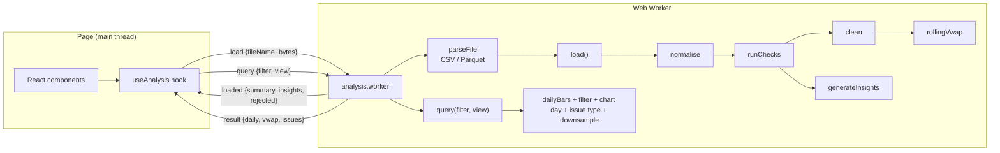

# Architecture

## In one paragraph

A single-page React app. When a file is uploaded, its bytes go to a background Web Worker. The worker parses the file and runs the whole pipeline once: normalise, then check, then clean, then analyse, then generate insights. It keeps the results in memory and sends back a summary. When the user changes a filter or a view option (chart day, issue type), the page sends a small query to the worker, which slices the results it already has. The page never does heavy work, so it stays responsive, even on a phone with a 100k-row file.

## Data flow

## Layers

Dependencies point inwards only. The domain doesn't know about React, browsers or file formats.

| Layer | Folder | Responsibility | Knows about |
|---|---|---|---|
| Domain | `src/domain/` | All business rules: normalising, quality checks, cleaning, daily bars, VWAP, insights | Nothing outside itself |
| Application | `src/application/analyse.ts` | Wires domain steps into two use cases: `load()` (once per file) and `query()` (every filter or view change). Also picks the chart's default day. | Domain |
| Infrastructure | `src/infrastructure/` | Turning file bytes into rows (Papa Parse, hyparquet); running the pipeline in a worker | Application, domain types |
| UI | `src/ui/` | Rendering state and sending user actions to the worker | Worker protocol, domain types |

Keeping the domain pure is what makes it easy to test: every rule is a plain function tested with a few hand-built bars.

## Domain modules

| Module | Input → output | Notes |
|---|---|---|
| `normalise.ts` | raw rows → `Bar[]` + `RejectedRow[]` | Column aliases, type coercion (string, number, bigint, Date), CME trading-day assignment, row numbers as the user sees them. Throws `MissingColumnsError` if the file is unusable. |
| `quality/checks.ts` | `Bar[]` → `QualityIssue[]` | Seven independent checks. They run on bars in their original file order, so duplicates and ordering problems are still visible. |
| `quality/clean.ts` | `Bar[]` → `Bar[]` | Removes impossible prices and duplicates (first wins), blanks negative volume, sorts. |
| `analytics/dailyBars.ts` | clean bars → `DailyBar[]` | Groups by contract and trading day. |
| `analytics/vwap.ts` | clean bars → `VwapPoint[]` | Time-based sliding window with running totals, O(n). |
| `analytics/filter.ts`, `downsample.ts` | | Contract and date filter; thins chart data to 2,000 points. |
| `insights/rules.ts` | issues + bars → `Insight[]` | Eight rules that find patterns and suggest a cleansing or validation rule. |
| `health.ts` | summary → verdict; bars + issues → per-contract health | The "can I use this data?" verdict (good / caveats / poor) and the by-contract breakdown. |
| `bars.ts` | | Group-by-contract helper; per-contract price decimals for display. |
| `time.ts` | | Wall-clock helpers, the CME session calendar, trading-day rule. |
| `types.ts`, `config.ts` | | Shared types, default thresholds, severity and plain-English labels per issue kind. |

### Key types

`QualityIssue` is a discriminated union on `kind`. Each kind carries only the fields that make sense for it (for example `gapMinutes` on a gap, `reason` on an invalid price). The UI uses an exhaustive `switch` to describe each kind. So when a new kind is added, TypeScript points at every place that needs to handle it, including the `SEVERITY` and `ISSUE_LABELS` maps in `config.ts`.

`Filter` and `ViewOptions` are deliberately separate:
- `Filter` (contract, date range) decides which data the market view and issue log cover.
- `ViewOptions` (chart day, issue type) only changes what's displayed.

So stepping the chart through days never shrinks the daily table. A new filter resets the chart day but keeps the chosen issue type.

The worker messages (`WorkerRequest`, `WorkerResponse`) are discriminated unions too. The worker's `switch` has a `never` check, so an unhandled message type is a compile error.

## The time convention

All timestamps are "wall-clock milliseconds": Chicago local time stored as if it were UTC. This one rule avoids a whole class of bugs:

- The source data is already in this form ([dataset README](https://huggingface.co/datasets/lynx1231/historical-futures-data-sample)), so there's no conversion to get wrong.
- Every read uses `getUTC*`, so the viewer's timezone and DST changes never shift the bars.
- Text timestamps without a timezone get a `Z` appended before parsing, for the same reason.

On top of that, `tradingDateFor()` assigns each bar to its CME trading day: anything at or after the 17:00 CT reopen counts towards the next day.

## Extension points

| To add… | Do this |
|---|---|
| A quality check | Write a `QualityCheck` function in `quality/checks.ts`, add it to the `checks` array, add its kind to `QualityIssue`, `SEVERITY` and `ISSUE_LABELS`. TypeScript then flags the UI `describe()` switch. |
| An insight rule | Write an `InsightRule` in `insights/rules.ts` and add it to `rules`. |
| A file format | Add a parser that returns `RawRecord[]` and a branch in `parsers/index.ts`. Nothing else changes. |
| A column alias | Add it to `ALIASES` in `normalise.ts`. |
| AI-generated insights | Add a rule (or a separate step after `generateInsights`) that sends the issue summary to an LLM. The `Insight` shape stays the same, so the UI needs no changes. |
| A bigger data engine | Re-implement the bodies of `load()` and `query()` (e.g. on DuckDB-WASM). The worker protocol and UI don't change. |

## Testing

| Level | Where | What it covers |
|---|---|---|
| Unit | `tests/unit/` | Each domain module with small hand-built bars; both parsers with real fixture bytes; the UI display formatters |
| Integration | `tests/integration/pipeline.test.ts` | File bytes → parser → `load()` → `query()`. Has exact expected counts and row numbers for every planted problem in `dirty.csv`, the view options, and sanity checks on real data. |

The sanity checks on real data:
- No rows are rejected.
- Minute volume adds up to the vendor's reported total (107,312,444).
- Daily bars line up with the vendor's daily file on most days.
- The expected insights appear.
- The chart opens on an active day rather than the near-empty final day.

The UI isn't covered by automated tests. It was checked by driving the running app in headless Chrome at 1280px and 390px widths.
